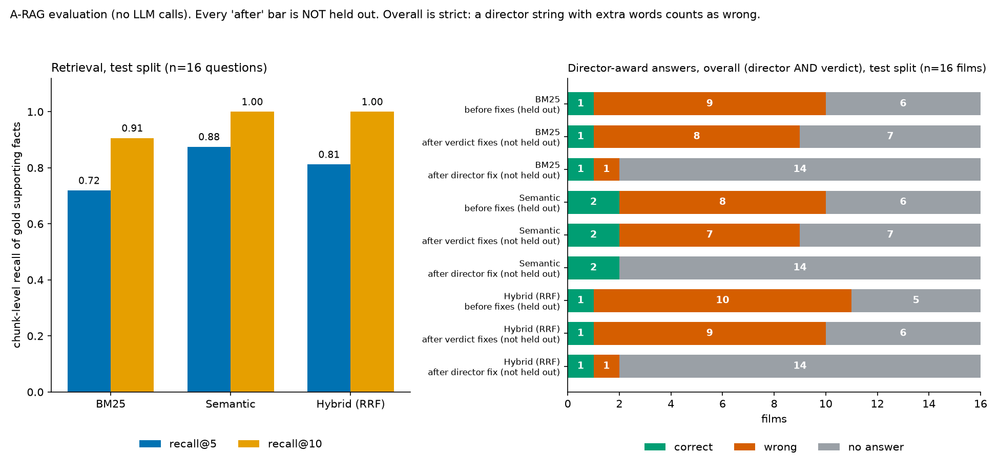

# Evaluation (free, no LLM calls)

Everything here runs on the committed indexes and the local embedding model. Reproduce with
`pip install -r requirements-eval.txt`, then `PYTHONPATH=. python eval/run_eval.py --out <dir>` and
`python eval/make_chart.py`. **These are small-sample results, not a general accuracy claim.**

## Method

**Track A: retrieval.** HotpotQA validation (fullwiki) questions whose gold supporting paragraphs are all in our
1,000-document corpus, using HotpotQA's own gold supporting facts. A *gold chunk* is any chunk of the gold
paragraph that contains the gold sentence (`eval/data/hotpot_subset.json`). Metric: **recall@5 / recall@10 at
chunk level**, plus "all gold chunks in the top k" with a Wilson 95% interval. Methods: **BM25**
(`keyword_search`), **semantic** (the shipped `semantic_search`, bge-small embeddings) and **hybrid** (BM25 +
semantic merged by reciprocal rank fusion, `scripts/prototype_hybrid.py`). Each retriever returns 100
candidates, de-duplicated to chunks.

**Track B: director-award answers.** 26 films whose pages are in the corpus (`eval/data/award_set.json`), asked
as "Who directed X and did they win any Academy Awards?" in evidence-only mode. Truth = the director's Oscar
outcome *for that film*: `won` / `nominated` / `no_win`. The **director is scored as its own column, strictly on the string the user sees**: **correct** (exactly the expected
name; co-directors joined with "and"), **malformed** (the right name with extra text attached, e.g. "Joe Dante and
produced by Michael Finnell"), **wrong** (another name) or no answer ("Unknown"). The **verdict** is correct, **wrong**
(a different positive claim) or no answer ("unknown"; absence of evidence cannot prove a negative, so this is never
counted as wrong). A row is **wrong overall if the director (wrong or malformed) OR the verdict is wrong**, correct
overall only if both are correct, and no answer otherwise. Counting malformed as wrong is a judgment call, so each
table also shows the lenient reading (a name with extra text accepted). Rows with the verdict passage:
`eval/results/*/awards_results.json`.

Rows with the verdict passage: `eval/results/*/awards_results.json`.

**Labels are agent-sourced, not owner-verified.** Every row carries `source_url`, `supporting_text` (verbatim,
at most 25 words) and `verified_by: "agent-sourced"`. `python eval/verify_award_labels.py` re-checks, against
the live Wikipedia pages, that each quote is on its page and that every `no_win` row's `absence_check` holds
(the director's full name, and also the surname alone and common first-name variants, are checked on the two
ceremony pages after the film's release; the pass count is in the results block below). No source contradicted a
label, so no label was corrected. The wider surname/variant match produced hits on four rows (Ed Wood, True Lies,
Total Recall, Sex and the City); in each the hit is a different person with the same name (recorded in the
`review` field), so no label changed. Two caveats: for the 15 `no_win` films with no
Oscar story at all, no sentence can show a negative, so their `supporting_text` is the ceremony's Best Directing
row and the claim rests on the absence check; and the Academy Awards database was not queried.

**Split.** Seed `20261030`, 40% dev / 60% test (`eval/data/splits.json`, committed). Retrieval 11 dev / 16 test;
awards 10 dev / 16 test (stratified by truth class). Only test-split numbers are reported below.

## Results, test split

The system answers in evidence-only mode: it can say "won", "nominated" or "unknown" (no answer), but it
**cannot output "no win"**. A `no_win` film therefore can never be scored correct: its best outcome is "no
answer", and any positive claim is wrong. "Coverage on answerable films" is correct ÷ (films whose truth is won
or nominated).

<!-- results:begin (generated by eval/render_eval_md.py; do not edit) -->

### Held-out, before fixes

From `eval/results/before_fixes/`. Nothing had been tuned on the test split at this point.

| Retrieval (n=16) | recall@5 | recall@10 | all gold in top 10 (95% interval) | MRR |
|---|---|---|---|---|
| BM25 | 0.72 | 0.91 | 13/16 (0.57 to 0.93) | 0.87 |
| Semantic | 0.88 | 1.00 | 16/16 (0.81 to 1.00) | 0.92 |
| Hybrid (RRF) | 0.81 | 1.00 | 16/16 (0.81 to 1.00) | 0.91 |

Paired on recall@10 (test): semantic beats BM25 on 3 of 16 questions and loses on 0; hybrid beats semantic on 0 and loses on 0 (16 tied), and has lower recall@5 (0.81 vs 0.88). **There is no evidence that hybrid retrieval helps at n=16.**

**Awards, test split, held-out, before fixes**

Cells are correct / wrong / no answer. A row is wrong overall if the director OR the verdict is wrong; it is correct overall only if both are correct.

| Truth class (n films), overall | BM25 | Semantic | Hybrid (RRF) |
|---|---|---|---|
| won (2) | 1 / 1 / 0 | 2 / 0 / 0 | 1 / 1 / 0 |
| nominated (1) | 0 / 1 / 0 | 0 / 1 / 0 | 0 / 1 / 0 |
| no_win (13) (never correct: the system has no "no win" output) | 0 / 7 / 6 | 0 / 7 / 6 | 0 / 8 / 5 |
| **all (16)** | 1 / 9 / 6 | 2 / 8 / 6 | 1 / 10 / 5 |
| *all, if a name with extra text were accepted as correct* | 1 / 3 / 12 | 2 / 2 / 12 | 1 / 4 / 11 |
| **coverage on answerable films** (overall correct ÷ answerable films) | 1/3 answerable films = 0.33 | 2/3 answerable films = 0.67 | 1/3 answerable films = 0.33 |

| Components (all 16 films) | BM25 | Semantic | Hybrid (RRF) |
|---|---|---|---|
| Verdict only | 1 / 3 / 12 | 2 / 2 / 12 | 1 / 3 / 12 |
| Director only (wrong includes malformed) | 7 / 7 / 2 | 7 / 7 / 2 | 7 / 8 / 1 |
| of which malformed: the right name with extra text attached | 7 | 7 | 7 |
| Verdict-only coverage | 1/3 answerable films = 0.33 | 2/3 answerable films = 0.67 | 1/3 answerable films = 0.33 |

This split has 13 of 16 films with truth `no_win`, so it mostly measures abstention: only 3 films can be answered correctly.

**Awards, all 26 films (dev + test), before fixes: descriptive, not a held-out estimate**

Cells are correct / wrong / no answer. A row is wrong overall if the director OR the verdict is wrong; it is correct overall only if both are correct.

| Truth class (n films), overall | BM25 | Semantic | Hybrid (RRF) |
|---|---|---|---|
| won (3) | 2 / 1 / 0 | 3 / 0 / 0 | 2 / 1 / 0 |
| nominated (2) | 0 / 1 / 1 | 0 / 1 / 1 | 0 / 1 / 1 |
| no_win (21) (never correct: the system has no "no win" output) | 0 / 11 / 10 | 0 / 12 / 9 | 0 / 12 / 9 |
| **all (26)** | 2 / 13 / 11 | 3 / 13 / 10 | 2 / 14 / 10 |
| *all, if a name with extra text were accepted as correct* | 2 / 3 / 21 | 3 / 3 / 20 | 2 / 4 / 20 |
| **coverage on answerable films** (overall correct ÷ answerable films) | 2/5 answerable films = 0.40 | 3/5 answerable films = 0.60 | 2/5 answerable films = 0.40 |

| Components (all 26 films) | BM25 | Semantic | Hybrid (RRF) |
|---|---|---|---|
| Verdict only | 2 / 3 / 21 | 3 / 2 / 21 | 2 / 3 / 21 |
| Director only (wrong includes malformed) | 12 / 11 / 3 | 12 / 12 / 2 | 12 / 12 / 2 |
| of which malformed: the right name with extra text attached | 11 | 11 | 11 |
| Verdict-only coverage | 2/5 answerable films = 0.40 | 3/5 answerable films = 0.60 | 2/5 answerable films = 0.40 |

These films include 21 of 26 films with truth `no_win`, so it mostly measures abstention: only 5 films can be answered correctly.

### After fixes: test split no longer held out

Two verdict faults were found on this test split and fixed (see below). The numbers here, from `eval/results/after_fixes/` (re-run on `main`), were produced **after** looking at this split, so they are **not held out** and say nothing about unseen films. Retrieval results are identical before and after.

**Awards, test split, after fixes (not held out)**

Cells are correct / wrong / no answer. A row is wrong overall if the director OR the verdict is wrong; it is correct overall only if both are correct.

| Truth class (n films), overall | BM25 | Semantic | Hybrid (RRF) |
|---|---|---|---|
| won (2) | 1 / 1 / 0 | 2 / 0 / 0 | 1 / 1 / 0 |
| nominated (1) | 0 / 1 / 0 | 0 / 1 / 0 | 0 / 1 / 0 |
| no_win (13) (never correct: the system has no "no win" output) | 0 / 6 / 7 | 0 / 6 / 7 | 0 / 7 / 6 |
| **all (16)** | 1 / 8 / 7 | 2 / 7 / 7 | 1 / 9 / 6 |
| *all, if a name with extra text were accepted as correct* | 1 / 1 / 14 | 2 / 0 / 14 | 1 / 2 / 13 |
| **coverage on answerable films** (overall correct ÷ answerable films) | 1/3 answerable films = 0.33 | 2/3 answerable films = 0.67 | 1/3 answerable films = 0.33 |

| Components (all 16 films) | BM25 | Semantic | Hybrid (RRF) |
|---|---|---|---|
| Verdict only | 1 / 1 / 14 | 2 / 0 / 14 | 1 / 1 / 14 |
| Director only (wrong includes malformed) | 7 / 7 / 2 | 7 / 7 / 2 | 7 / 8 / 1 |
| of which malformed: the right name with extra text attached | 7 | 7 | 7 |
| Verdict-only coverage | 1/3 answerable films = 0.33 | 2/3 answerable films = 0.67 | 1/3 answerable films = 0.33 |

This split has 13 of 16 films with truth `no_win`, so it mostly measures abstention: only 3 films can be answered correctly.

**Awards, all 26 films (dev + test), after fixes: descriptive, not a held-out estimate**

Cells are correct / wrong / no answer. A row is wrong overall if the director OR the verdict is wrong; it is correct overall only if both are correct.

| Truth class (n films), overall | BM25 | Semantic | Hybrid (RRF) |
|---|---|---|---|
| won (3) | 2 / 1 / 0 | 3 / 0 / 0 | 2 / 1 / 0 |
| nominated (2) | 0 / 1 / 1 | 0 / 1 / 1 | 0 / 1 / 1 |
| no_win (21) (never correct: the system has no "no win" output) | 0 / 10 / 11 | 0 / 11 / 10 | 0 / 11 / 10 |
| **all (26)** | 2 / 12 / 12 | 3 / 12 / 11 | 2 / 13 / 11 |
| *all, if a name with extra text were accepted as correct* | 2 / 1 / 23 | 3 / 1 / 22 | 2 / 2 / 22 |
| **coverage on answerable films** (overall correct ÷ answerable films) | 2/5 answerable films = 0.40 | 3/5 answerable films = 0.60 | 2/5 answerable films = 0.40 |

| Components (all 26 films) | BM25 | Semantic | Hybrid (RRF) |
|---|---|---|---|
| Verdict only | 2 / 1 / 23 | 3 / 0 / 23 | 2 / 1 / 23 |
| Director only (wrong includes malformed) | 12 / 11 / 3 | 12 / 12 / 2 | 12 / 12 / 2 |
| of which malformed: the right name with extra text attached | 11 | 11 | 11 |
| Verdict-only coverage | 2/5 answerable films = 0.40 | 3/5 answerable films = 0.60 | 2/5 answerable films = 0.40 |

These films include 21 of 26 films with truth `no_win`, so it mostly measures abstention: only 5 films can be answered correctly.

Wrong overall (director or verdict), after fixes:

Test split:

- BM25: The Godfather [test] (verdict nominated, truth won); About a Boy (film) [test] (malformed director "brothers Chris Weitz and Paul Weitz with music by ", expected Chris Weitz and Paul Weitz); Innerspace [test] (malformed director "Joe Dante and produced by Michael Finnell", expected Joe Dante); End of Days (film) [test] (malformed director "Peter Hyams and starring Arnold Schwarzenegger", expected Peter Hyams); Hackers (film) [test] (malformed director "Iain Softley and starring Jonny Lee Miller", expected Iain Softley); Deliver Us from Evil (2014 film) [test] (malformed director "Scott Derrickson and produced by Jerry Bruckheimer", expected Scott Derrickson); Hellraiser: Inferno [test] (malformed director "Scott Derrickson and released on October", expected Scott Derrickson); Season of the Witch (2011 film) [test] (malformed director "Dominic Sena with extensive uncredited reshoots by", expected Dominic Sena)
- Semantic: About a Boy (film) [test] (malformed director "brothers Chris Weitz and Paul Weitz with music by ", expected Chris Weitz and Paul Weitz); Innerspace [test] (malformed director "Joe Dante and produced by Michael Finnell", expected Joe Dante); End of Days (film) [test] (malformed director "Peter Hyams and starring Arnold Schwarzenegger", expected Peter Hyams); Hackers (film) [test] (malformed director "Iain Softley and starring Jonny Lee Miller", expected Iain Softley); Deliver Us from Evil (2014 film) [test] (malformed director "Scott Derrickson and produced by Jerry Bruckheimer", expected Scott Derrickson); Hellraiser: Inferno [test] (malformed director "Scott Derrickson and released on October", expected Scott Derrickson); Season of the Witch (2011 film) [test] (malformed director "Dominic Sena with extensive uncredited reshoots by", expected Dominic Sena)
- Hybrid (RRF): The Godfather [test] (verdict nominated, truth won); About a Boy (film) [test] (malformed director "brothers Chris Weitz and Paul Weitz with music by ", expected Chris Weitz and Paul Weitz); Innerspace [test] (malformed director "Joe Dante and produced by Michael Finnell", expected Joe Dante); Romeo + Juliet [test] (wrong director "William Woodman and starring Alex Hyde-White as Ro", expected Baz Luhrmann); End of Days (film) [test] (malformed director "Peter Hyams and starring Arnold Schwarzenegger", expected Peter Hyams); Hackers (film) [test] (malformed director "Iain Softley and starring Jonny Lee Miller", expected Iain Softley); Deliver Us from Evil (2014 film) [test] (malformed director "Scott Derrickson and produced by Jerry Bruckheimer", expected Scott Derrickson); Hellraiser: Inferno [test] (malformed director "Scott Derrickson and released on October", expected Scott Derrickson); Season of the Witch (2011 film) [test] (malformed director "Dominic Sena with extensive uncredited reshoots by", expected Dominic Sena)

All 26 films (dev + test):

- BM25: The Godfather [test] (verdict nominated, truth won); About a Boy (film) [test] (malformed director "brothers Chris Weitz and Paul Weitz with music by ", expected Chris Weitz and Paul Weitz); Innerspace [test] (malformed director "Joe Dante and produced by Michael Finnell", expected Joe Dante); City of Angels (film) [dev] (malformed director "Brad Silberling and starring Nicolas Cage and Meg ", expected Brad Silberling); End of Days (film) [test] (malformed director "Peter Hyams and starring Arnold Schwarzenegger", expected Peter Hyams); Hackers (film) [test] (malformed director "Iain Softley and starring Jonny Lee Miller", expected Iain Softley); Sex and the City (film) [dev] (malformed director "Michael Patrick King in his feature film directori", expected Michael Patrick King); The Exorcism of Emily Rose [dev] (malformed director "Scott Derrickson and starring Laura Linney and Tom", expected Scott Derrickson); Sinister (film) [dev] (malformed director "Scott Derrickson and written by Derrickson and C", expected Scott Derrickson); Deliver Us from Evil (2014 film) [test] (malformed director "Scott Derrickson and produced by Jerry Bruckheimer", expected Scott Derrickson); Hellraiser: Inferno [test] (malformed director "Scott Derrickson and released on October", expected Scott Derrickson); Season of the Witch (2011 film) [test] (malformed director "Dominic Sena with extensive uncredited reshoots by", expected Dominic Sena)
- Semantic: About a Boy (film) [test] (malformed director "brothers Chris Weitz and Paul Weitz with music by ", expected Chris Weitz and Paul Weitz); Innerspace [test] (malformed director "Joe Dante and produced by Michael Finnell", expected Joe Dante); City of Angels (film) [dev] (malformed director "Brad Silberling and starring Nicolas Cage and Meg ", expected Brad Silberling); End of Days (film) [test] (malformed director "Peter Hyams and starring Arnold Schwarzenegger", expected Peter Hyams); Last Action Hero [dev] (wrong director "Kathryn Bigelow", expected John McTiernan); Hackers (film) [test] (malformed director "Iain Softley and starring Jonny Lee Miller", expected Iain Softley); Sex and the City (film) [dev] (malformed director "Michael Patrick King in his feature film directori", expected Michael Patrick King); The Exorcism of Emily Rose [dev] (malformed director "Scott Derrickson and starring Laura Linney and Tom", expected Scott Derrickson); Sinister (film) [dev] (malformed director "Scott Derrickson and written by Derrickson and C", expected Scott Derrickson); Deliver Us from Evil (2014 film) [test] (malformed director "Scott Derrickson and produced by Jerry Bruckheimer", expected Scott Derrickson); Hellraiser: Inferno [test] (malformed director "Scott Derrickson and released on October", expected Scott Derrickson); Season of the Witch (2011 film) [test] (malformed director "Dominic Sena with extensive uncredited reshoots by", expected Dominic Sena)
- Hybrid (RRF): The Godfather [test] (verdict nominated, truth won); About a Boy (film) [test] (malformed director "brothers Chris Weitz and Paul Weitz with music by ", expected Chris Weitz and Paul Weitz); Innerspace [test] (malformed director "Joe Dante and produced by Michael Finnell", expected Joe Dante); Romeo + Juliet [test] (wrong director "William Woodman and starring Alex Hyde-White as Ro", expected Baz Luhrmann); City of Angels (film) [dev] (malformed director "Brad Silberling and starring Nicolas Cage and Meg ", expected Brad Silberling); End of Days (film) [test] (malformed director "Peter Hyams and starring Arnold Schwarzenegger", expected Peter Hyams); Hackers (film) [test] (malformed director "Iain Softley and starring Jonny Lee Miller", expected Iain Softley); Sex and the City (film) [dev] (malformed director "Michael Patrick King in his feature film directori", expected Michael Patrick King); The Exorcism of Emily Rose [dev] (malformed director "Scott Derrickson and starring Laura Linney and Tom", expected Scott Derrickson); Sinister (film) [dev] (malformed director "Scott Derrickson and written by Derrickson and C", expected Scott Derrickson); Deliver Us from Evil (2014 film) [test] (malformed director "Scott Derrickson and produced by Jerry Bruckheimer", expected Scott Derrickson); Hellraiser: Inferno [test] (malformed director "Scott Derrickson and released on October", expected Scott Derrickson); Season of the Witch (2011 film) [test] (malformed director "Dominic Sena with extensive uncredited reshoots by", expected Dominic Sena)

Films where some method's director string is not exactly right (output per method):

| Film | Split | BM25 | Semantic | Hybrid (RRF) |
|---|---|---|---|---|
| About a Boy (film) | test | **MALFORMED**: "brothers Chris Weitz and Paul Weitz with music" | **MALFORMED**: "brothers Chris Weitz and Paul Weitz with music" | **MALFORMED**: "brothers Chris Weitz and Paul Weitz with music" |
| Ed Wood (film) | test | Unknown | Unknown | Unknown |
| Innerspace | test | **MALFORMED**: "Joe Dante and produced by Michael Finnell" | **MALFORMED**: "Joe Dante and produced by Michael Finnell" | **MALFORMED**: "Joe Dante and produced by Michael Finnell" |
| Romeo + Juliet | test | Unknown | Unknown | **WRONG**: "William Woodman and starring Alex Hyde-White a" |
| City of Angels (film) | dev | **MALFORMED**: "Brad Silberling and starring Nicolas Cage and " | **MALFORMED**: "Brad Silberling and starring Nicolas Cage and " | **MALFORMED**: "Brad Silberling and starring Nicolas Cage and " |
| End of Days (film) | test | **MALFORMED**: "Peter Hyams and starring Arnold Schwarzenegger" | **MALFORMED**: "Peter Hyams and starring Arnold Schwarzenegger" | **MALFORMED**: "Peter Hyams and starring Arnold Schwarzenegger" |
| Last Action Hero | dev | Unknown | **WRONG**: "Kathryn Bigelow" | Unknown |
| Hackers (film) | test | **MALFORMED**: "Iain Softley and starring Jonny Lee Miller" | **MALFORMED**: "Iain Softley and starring Jonny Lee Miller" | **MALFORMED**: "Iain Softley and starring Jonny Lee Miller" |
| Sex and the City (film) | dev | **MALFORMED**: "Michael Patrick King in his feature film direc" | **MALFORMED**: "Michael Patrick King in his feature film direc" | **MALFORMED**: "Michael Patrick King in his feature film direc" |
| The Exorcism of Emily Rose | dev | **MALFORMED**: "Scott Derrickson and starring Laura Linney and" | **MALFORMED**: "Scott Derrickson and starring Laura Linney and" | **MALFORMED**: "Scott Derrickson and starring Laura Linney and" |
| Sinister (film) | dev | **MALFORMED**: "Scott Derrickson and written by Derrickson and" | **MALFORMED**: "Scott Derrickson and written by Derrickson and" | **MALFORMED**: "Scott Derrickson and written by Derrickson and" |
| Deliver Us from Evil (2014 film) | test | **MALFORMED**: "Scott Derrickson and produced by Jerry Bruckhe" | **MALFORMED**: "Scott Derrickson and produced by Jerry Bruckhe" | **MALFORMED**: "Scott Derrickson and produced by Jerry Bruckhe" |
| Hellraiser: Inferno | test | **MALFORMED**: "Scott Derrickson and released on October" | **MALFORMED**: "Scott Derrickson and released on October" | **MALFORMED**: "Scott Derrickson and released on October" |
| Season of the Witch (2011 film) | test | **MALFORMED**: "Dominic Sena with extensive uncredited reshoot" | **MALFORMED**: "Dominic Sena with extensive uncredited reshoot" | **MALFORMED**: "Dominic Sena with extensive uncredited reshoot" |

### After the director-detection fix: NOT held out

The fix was written while looking at these films (Ed Wood: test split, Romeo + Juliet: test split, Last Action Hero: dev split), so every number in this section is **not held out**; it shows what the change did on films it was developed on, not how it behaves on unseen ones. Retrieval results are identical before and after.

**Director fix, test split (n=16)** (cells: correct / wrong / no answer)

| | BM25: before | BM25: after | Semantic: before | Semantic: after | Hybrid (RRF): before | Hybrid (RRF): after |
|---|---|---|---|---|---|---|
| Overall (director AND verdict, strict) | 1 / 8 / 7 | 1 / 1 / 14 | 2 / 7 / 7 | 2 / 0 / 14 | 1 / 9 / 6 | 1 / 1 / 14 |
| Director only (wrong includes malformed) | 7 / 7 / 2 | 16 / 0 / 0 | 7 / 7 / 2 | 16 / 0 / 0 | 7 / 8 / 1 | 16 / 0 / 0 |
| Verdict only | 1 / 1 / 14 | 1 / 1 / 14 | 2 / 0 / 14 | 2 / 0 / 14 | 1 / 1 / 14 | 1 / 1 / 14 |
| Director strings that are the right name plus extra words | 7 | 0 | 7 | 0 | 7 | 0 |

**Director fix, all 26 films (dev + test)** (cells: correct / wrong / no answer)

| | BM25: before | BM25: after | Semantic: before | Semantic: after | Hybrid (RRF): before | Hybrid (RRF): after |
|---|---|---|---|---|---|---|
| Overall (director AND verdict, strict) | 2 / 12 / 12 | 2 / 1 / 23 | 3 / 12 / 11 | 3 / 0 / 23 | 2 / 13 / 11 | 2 / 1 / 23 |
| Director only (wrong includes malformed) | 12 / 11 / 3 | 26 / 0 / 0 | 12 / 12 / 2 | 26 / 0 / 0 | 12 / 12 / 2 | 26 / 0 / 0 |
| Verdict only | 2 / 1 / 23 | 2 / 1 / 23 | 3 / 0 / 23 | 3 / 0 / 23 | 2 / 1 / 23 | 2 / 1 / 23 |
| Director strings that are the right name plus extra words | 11 | 0 | 11 | 0 | 11 | 0 |

Director strings still not exactly right after the fix: none.

Label sourcing check (`python eval/verify_award_labels.py`): 26 of 26 award rows pass; 4 of them needed a manual reading of the passages.

<!-- results:end -->

What the two verdict fixes changed: *Innerspace* (the film's Best Visual Effects win, "the only film directed by
Dante to do so") and *Silent Light* (an Independent Spirit nomination) became "no answer". **Wrong rows that
remain are listed above, by method.** Most are *malformed directors*: the extractor returns the right name followed
by extra words, so the strict overall counts are far worse than the lenient row beside them. Only the lenient row
(or the verdict-only components) is comparable with the verdict-only numbers reported earlier; any "0 wrong" claim
holds only for the reading and the split it names.

## Limits

- **Small n.** 16 test questions and 16 test films: one question moves recall by about 6 points and the
  intervals are wide. Differences of a question or two are noise.
- **Retrieval is likely optimistic.** The corpus was built from the contexts of the first validation questions,
  so every usable question has its distractors in the corpus; only 27 of 7,405 questions qualify.
- Award rows are not independent (Derrickson 4 films, Cameron 2); most films have no Oscar story, so "no
  answer" dominates by design. Director detection **was** poor in two ways, both addressed in the director-detection change (see the section
  above; its numbers are not held out): (1) the name capture ran past the name, so 11 of 26 answers said things like
  "Joe Dante and produced by Michael Finnell"; (2) the extractor only matched the literal phrase "directed by" and
  accepted any "directed by" sentence, so *Ed Wood* ("directed and produced by Tim Burton"), *Romeo + Juliet*
  ("directed, co-produced, and co-written by Baz Luhrmann") and *Last Action Hero* ("directed and produced by John
  McTiernan") were missed, and Last Action Hero (semantic) and Romeo + Juliet (hybrid) got a **wrong** director from
  an unrelated passage ("Cameron served as executive producer for Point Break (1991), directed by Kathryn
  Bigelow"). After the change all 26 director strings are exactly right, but only these 26 films (plus 7 regression
  films) were tried, and the change was written looking at them.
- Chunks are 200-word windows, so chunk-level gold is usually the whole paragraph.
